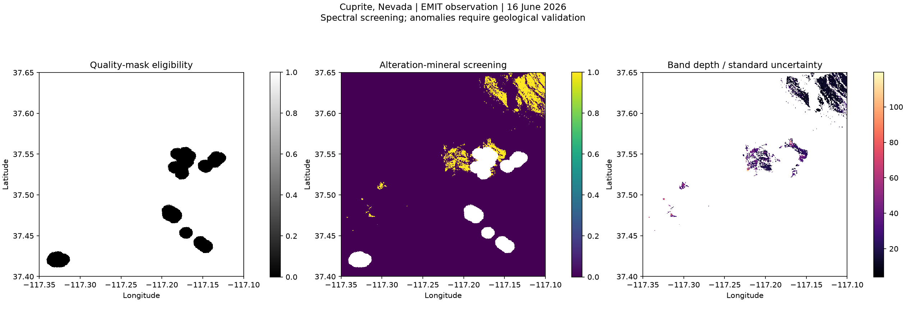

# EMIT Cuprite pilot

Acquisition: **16 June 2026, 19:48:59 UTC**. Product: `EMIT_L2B_MIN_001_20260616T194859_2616713_011`.
Both paired L2B files and the matching L2A quality mask were downloaded and processed.
The selected footprint covers the entire configured AOI. Scene-wide reported cloud cover:
**3.0%** (not an AOI-specific cloud estimate).

## Observations

- Eligible native map-grid cells: **202,839**.
- Candidate alteration-mineral cells: **7,670**
  (**3.78%** of eligible cells).
- Retained contiguous regions, minimum nine map-grid cells: **44**.
- Combined retained polygon area: **2044.8 ha**.
- Matched library entries include kaolinite, alunite, dickite and mixtures. These are
  library-entry matches, not independent confirmation of each mineral component.

## Largest screening regions

This table is ordered by area; the CSV also includes an uncalibrated screening score.

| Region | Area (ha) | Longitude | Latitude | Median depth/uncertainty |
|---|---:|---:|---:|---:|
| 12 | 542.2 | -117.12128 | 37.62368 | 11.81 |
| 17 | 320.0 | -117.15985 | 37.62791 | 11.59 |
| 6 | 288.3 | -117.11258 | 37.63546 | 12.23 |
| 203 | 271.7 | -117.20513 | 37.53989 | 19.91 |
| 178 | 191.5 | -117.15926 | 37.55427 | 24.78 |

## Threshold sensitivity

| Minimum SNR | Minimum depth | Candidate cells | Retained regions |
|---:|---:|---:|---:|
| 2 | 0.005 | 7,670 | 44 |
| 2 | 0.01 | 7,670 | 44 |
| 2 | 0.02 | 7,666 | 44 |
| 3 | 0.005 | 7,670 | 44 |
| 3 | 0.01 | 7,670 | 44 |
| 3 | 0.02 | 7,666 | 44 |
| 5 | 0.005 | 7,667 | 44 |
| 5 | 0.01 | 7,667 | 44 |
| 5 | 0.02 | 7,663 | 44 |

Region counts can increase as thresholds split connected patches. These tests measure parameter
sensitivity on one observation, not classification accuracy or repeatability through time.

## Interpretation limits and next work

These outputs identify surface spectral anomalies for review. They do not establish an
economic mineral deposit. Alunite, dickite and other additional mineral classes need particular
validation in exploration applications. The fit score was not thresholded because its scaling
requires verification for this processing revision. Masks do not remove every vegetation,
shadow or atmospheric artifact. Geographic grid cells can repeat source pixels.

Next: inspect L2A reflectance spectra against reference spectra, evaluate a second scene,
overlay published geology/alteration/faults, and validate selected exposures with field spectra,
XRD and geochemistry. No full reflectance cube, reference-spectrum fitting, independent map
comparison or field validation was performed in this run.

See `run.json` for exact configuration and input hashes; `selection.json` in the parent
folder records CMR metadata.
